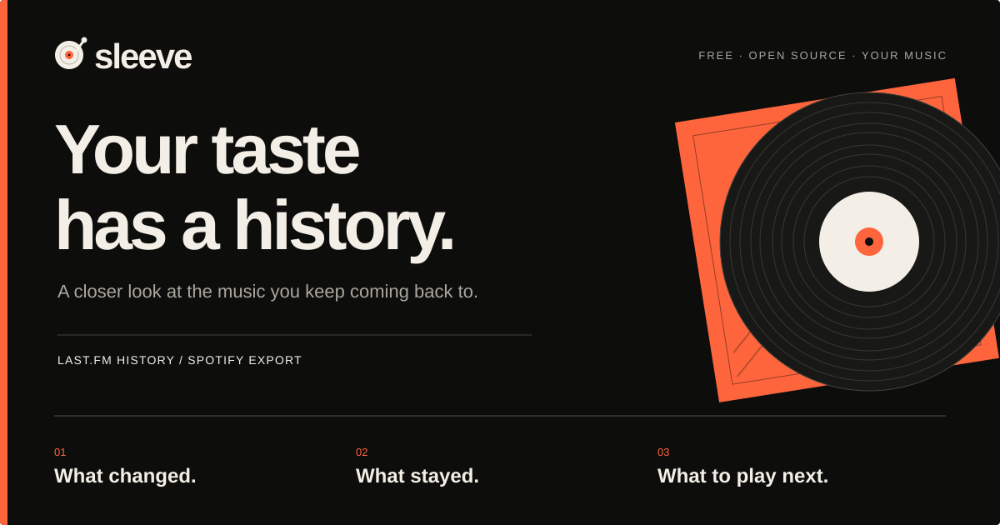

<p align="center">
  <a href="https://liner-c7u.pages.dev/">
    
  </a>
</p>

<p align="center">
  <strong>Your favorite artist was not always your favorite artist.</strong><br>
  Find the first plays, the years that belonged to them, and the records waiting for another listen.
</p>

<p align="center">
  <a href="https://liner-c7u.pages.dev/#/start"><strong>Try Sleeve →</strong></a>
  &nbsp; · &nbsp;
  <a href="https://liner-c7u.pages.dev/#/demo"><strong>Explore the demo</strong></a>
  &nbsp; · &nbsp;
  <a href="#run-it-yourself">Run it yourself</a>
</p>

<p align="center">
  <a href="LICENSE"></a>
  <a href="https://github.com/owenawsong/liner/actions/workflows/check.yml"></a>
</p>

## A listening history worth opening

**Sleeve turns your Last.fm history or Spotify export into a personal music record.** Follow your taste month by month, find the discoveries that stayed, revisit old favorites, and choose your next record through connections to music you actually play.

**[The website is live on Cloudflare Pages.](https://liner-c7u.pages.dev/)** No installation, Sleeve account, or API key required to try it. The demo opens immediately; your own history takes a little time to prepare.

### Go deeper than a top ten

| Find out… | Follow it into… |
| --- | --- |
| **When an artist became your artist** | First plays, repeat months, peak listening and a detailed artist history. |
| **What changed—and what kept coming back** | Equal-period comparisons, rising artists, returns, lasting discoveries and genre history. |
| **What a year actually sounded like** | Month-by-month timelines, listening eras, any year's review and a shareable year image. |
| **What to play after your current rotation** | Catalogue-checked albums and starting tracks connected to recent favorites and older listening. Save, pass, mark already heard or undo. |
| **Where your listening habits take shape** | Listening clocks, repeat runs, breadth, concentration, audience reach and questions answered from your saved record. |

Start with the **[overview](https://liner-c7u.pages.dev/#/demo)**, follow a **[change](https://liner-c7u.pages.dev/#/demo/evolution)**, or open **[Discover](https://liner-c7u.pages.dev/#/demo/discover)**. The demo uses real music with synthetic plays; it is an example, not someone else's private history.

## Bring your listening

1. **[Open Sleeve](https://liner-c7u.pages.dev/#/start).** Enter an existing Last.fm username, or choose your Spotify history ZIP.
2. **Let your record come together.** Import progress, artist checks, listening notes and recommendations have separate statuses. Saved checkpoints help an interrupted setup continue; you can explore before optional checks finish.
3. **Follow what interests you.** Open an artist, compare a period, revisit a record or save something to try next. Your imported record stays in this browser for your next visit.

A new Last.fm account starts tracking future plays; it cannot retrieve earlier Spotify listening. A Spotify export is optional, and Sleeve reads its ZIP **inside your browser**. Direct Spotify is an advanced connection requiring your own developer app—it is not the main setup path. [Data source details](docs/DATA_ACCESS_DECISION.md).

## Your record, with useful context

- **Your history stays on your device.** Imports and preferences live in browser storage. Catalogue and artwork lookups contact their providers. Optional AI writing sends a compact derived summary, which can include a display name, through Sleeve's server to its provider. [Read the data policy](PRIVACY.md).
- **The statistics work with AI off.** Optional, automatically prepared liner notes put calculated findings into words. Disable writing in Settings before setup if you prefer. Hosted writing has a shared allowance and may be unavailable; exact findings remain usable.
- **Discover gives you a starting point.** Recommendations include a listening connection and a real album or catalogue track. Your saved shelf and feedback stay local, with JSON backup/import.
- **Community opinion is supporting context.** MusicBrainz scores appear where enough people have voted. Album of the Year and Rate Your Music are outbound searches, not imported rating feeds.
- **Missing data stays missing.** Tempo and key appear only for recordings with usable verified audio analysis, with coverage visible. The current historical dataset has limited newer-song coverage. Sleeve does not invent mood, energy or musical key from a listening log.
- **Make it yours.** Bold themes, counting controls, reversible exclusions, local profiles and an installable app shell. Saved listening can still be explored offline; fresh metadata and AI need a connection.

The frontend, analysis, recommendation engine, AI prompts and validators, Pages Functions and budget Worker are all included under **[MIT](LICENSE)**. Provider credentials, hosting-account configuration and personal listening data are excluded. There is no proprietary analyzer or paid tier in this release.

## Run it yourself

Use **Node.js 22 or 24**:

```sh
git clone https://github.com/owenawsong/liner.git
cd liner
npm ci
npm run preview
```

Open **http://127.0.0.1:5178**. Demo views and local Spotify-file analysis need no API keys. Restart the preview after source edits to rebuild its public snapshot.

<details>
<summary><strong>Live Last.fm, local AI and Windows development</strong></summary>

For live Last.fm, add your own read key in Settings or supply `LASTFM_API_KEY` to the build. It is public browser configuration, not a private inference token.

On Windows, `scripts/dev.ps1` stages public files separately and loads optional private Function bindings. Copy [.dev.vars.example](.dev.vars.example) to `%USERPROFILE%\.sleeve\dev\.dev.vars`, add an optional `OPENROUTER_API_KEY`, then run:

```powershell
.\scripts\dev.ps1
```

Restart after changing credentials or source. NVIDIA is an optional local-development fallback; public requests use OpenRouter. See [AI configuration and limits](docs/AI_LAUNCH.md).

Serve the generated public build, not the checkout. Keep provider credentials outside public assets and Git.

</details>

### Host your own copy on Cloudflare

`npm run build` creates **`dist/`**, the public frontend. Cloudflare Pages serves it and builds `functions/` separately. Statistics and demo views work without AI credentials; hosted AI also needs the separate shared-budget Worker and an encrypted provider secret.

Follow the **[Cloudflare deployment guide](docs/DEPLOYMENT.md)** for build settings, optional Last.fm configuration, Function secrets and the budget binding. Using the [existing hosted website](https://liner-c7u.pages.dev/) requires none of that setup.

## Help shape Sleeve

Found a confusing chart, a bad recommendation, or a missing piece of your listening record? **[Open an issue](https://github.com/owenawsong/liner/issues/new/choose).** Include the action, what you expected and what happened; leave out raw archives and credentials.

Design, accessibility, import reliability, catalogue matching and clearer findings are especially welcome. **[Contributor guide](CONTRIBUTING.md)** · **[Feature & architecture reference](docs/FEATURES.md)** · **[Changelog](CHANGELOG.md)** · **[Security reporting](SECURITY.md)** · **[Third-party notices](THIRD_PARTY_NOTICES.md)**

The source repository and Cloudflare project retain the historical name `liner`; the app is **Sleeve**. Existing routes and saved records keep working.
